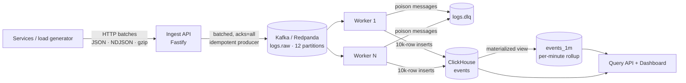

# log-pipeline

A high-throughput log aggregation and analytics pipeline. Services send logs over HTTP; the pipeline buffers them in Kafka, processes them with horizontally scalable workers, stores them in ClickHouse, and serves real-time analytics through a query API and live dashboard.

It is built around the two things that break naive log systems under load: **databases falling over from too many small writes**, and **events silently disappearing** when something downstream is slow or down.



## How it handles load without losing events

| Problem | What the pipeline does |
|---|---|
| Traffic bursts overwhelm the database | Kafka sits between ingest and storage and absorbs the burst. Workers drain it at the rate ClickHouse can sustain. |
| Too many small inserts kill ClickHouse | Ingest coalesces concurrent requests into large Kafka batches; workers merge rows from all their partitions into inserts of up to 10,000 rows. |
| Ingest process crashes after replying 200 | The API replies `202` only **after** Kafka acknowledges the batch (`acks=all`). An accepted event is already replicated. |
| Kafka is slow or down | Pending work is bounded. Past the limit the API returns `503` + `Retry-After` instead of buffering until it runs out of memory. |
| Worker crashes mid-batch | Offsets are committed only **after** the ClickHouse insert succeeds (at-least-once). Redelivered rows carry the same `event_id` and are collapsed by `ReplacingMergeTree`. |
| ClickHouse is briefly unavailable | Inserts retry with exponential backoff and jitter; if retries run out, the batch is redelivered from Kafka rather than dropped. |
| One malformed message | Classified as poison and sent to the `logs.dlq` topic with the error and source offset, so it can't block its partition. |
| Dashboards get slower as data grows | Aggregate queries read a per-minute rollup maintained by a materialized view, so their cost doesn't grow with raw volume. |

## Quick start

Requires Docker and Node.js 20+.

```bash
npm install
docker compose up -d --build        # Redpanda, ClickHouse, migrations, ingest, 2 workers, query API
npm run loadgen -- --rate 10000 --duration 60
```

Then open:

- **Dashboard:** http://localhost:8081
- **Kafka console** (topics, consumer lag, DLQ): http://localhost:8088
- **Prometheus:** http://localhost:9090

Scale the processing tier while traffic is flowing:

```bash
docker compose up -d --scale worker=4
```

Simulate an incident (the payments service starts failing and slowing down) and watch it show up on the dashboard:

```bash
npm run loadgen -- --rate 5000 --duration 120 --incident
```

## Sending logs

```bash
curl -X POST http://localhost:8080/v1/logs \
  -H 'x-api-key: dev-key' -H 'content-type: application/json' \
  -d '[{
        "service": "orders",
        "level": "error",
        "message": "payment provider timeout",
        "trace_id": "4bf92f3577b34da6",
        "http": { "method": "POST", "path": "/orders/1234/pay", "status": 504, "duration_ms": 3012 },
        "attributes": { "region": "nairobi" }
      }]'
```

```json
{ "accepted": 1, "rejected": 0, "errors": [] }
```

- Body can be one event, an array, or `{ "events": [...] }`. NDJSON (`application/x-ndjson`) and `Content-Encoding: gzip` are supported.
- Only `service` and `message` are required. `timestamp` may be ISO-8601, epoch seconds or epoch milliseconds; missing or implausible values fall back to receive time.
- Invalid events are rejected individually; valid events in the same request are still accepted. The response lists the index and reason for up to 20 rejects.
- Send your own `id` per event if you retry requests: duplicates with the same id collapse in storage.

| Status | Meaning |
|---|---|
| `202` | Accepted and durable in Kafka |
| `400` | Nothing valid in the request |
| `401` | Missing or wrong `x-api-key` |
| `413` | Too many events or body too large |
| `503` | Backpressure or Kafka unavailable. Retry after `Retry-After` seconds |

## Query API

All endpoints take `minutes` (window, max 7 days) and optionally `service`.

| Endpoint | Returns |
|---|---|
| `GET /api/overview` | Events/sec, error rate, 5xx rate, p50/p95/p99 latency, end-to-end pipeline lag |
| `GET /api/timeseries` | Bucketed events, errors and latency percentiles for charts |
| `GET /api/services` | Per-service volume, error rate and p95 |
| `GET /api/routes` | Top HTTP routes (ids collapsed, e.g. `/orders/:id`) by traffic |
| `GET /api/logs` | Raw log search: `q` (text), `level`, `trace_id`, `min_status`, `limit` |

All user input reaches ClickHouse as typed query parameters, never string-concatenated SQL.

## Project layout

```
src/
  ingest/     HTTP API, validation, Kafka producer
  worker/     Kafka consumer, transform, ClickHouse sink, DLQ
  query/      analytics API + dashboard (public/index.html)
  shared/     config, schema, normalization, batcher, retry, clients
migrations/   ClickHouse schema (events table + per-minute rollup)
scripts/      migrate.js, loadgen.js
deploy/       Prometheus config
test/         unit and HTTP tests (node:test)
```

## Design notes

**Storage schema.** `events` is a `ReplacingMergeTree` partitioned by day and sorted by `(service, level, timestamp, event_id)`, since nearly every query filters on service and level first. Messages use ZSTD compression, and a token bloom filter index lets text search skip most of the data. Raw events expire after 30 days by dropping whole partitions; the rollup is kept for 180.

**Enrichment.** Workers normalize timestamps, uppercase HTTP methods, infer a level from the status code when missing, and collapse numeric, UUID and hash path segments into `:id` so routes can be grouped without exploding cardinality.

**Trade-off: rollup counts.** The materialized view counts every inserted row, so if a worker crash causes a batch to be redelivered, the per-minute rollup briefly over-counts that batch while the raw table deduplicates it. For exact counts on raw data, query `events FINAL`.

**Why Redpanda.** It speaks the Kafka protocol, so the code uses a standard Kafka client and runs unchanged against Apache Kafka, MSK or Confluent, but it starts as a single lightweight container for local development.

## Configuration

Everything is set through environment variables. See [`src/shared/config.js`](src/shared/config.js) for the full list and [`.env.example`](.env.example) for the common ones.

## Benchmarks

Run against your own machine:

```bash
npm run loadgen -- --rate 0 --duration 60 --concurrency 32 --batch 2000
```

`--rate 0` sends as fast as possible and reports accepted events/sec, request latency percentiles, and how many requests were pushed back with `503`. Watch `worker_consumer_lag` in Prometheus or the Kafka console to see whether the workers keep up; add workers with `--scale worker=N` if lag grows.

## Tests

```bash
npm test
```

Covers validation, normalization, batching and backpressure, the ingest HTTP contract (auth, partial acceptance, gzip NDJSON, 503 behaviour), worker transforms and DLQ classification, retries, and query parameter handling.
